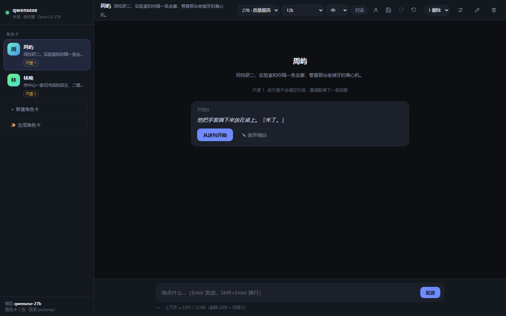

# qwensese

A local-first, zero-dependency character roleplay console for Ollama. A pure Python
standard-library HTTP server serves a single-page web UI, assembles the system prompt
fresh on every request, and streams tokens straight from your local model — no cloud,
no account, no API key, no third-party Python packages.

中文说明见下方；文档索引在文末。



## 中文说明

### 这个项目解决什么问题

- **对话不出本机**：模型权重跑在你自己的机器上，前端、服务端、Ollama 全部在本机回环地址，不需要联网也不需要账号。
- **角色卡就是 Markdown**：`personas/*.md` 用 `## 字段名` 分段，页面里改完保存立刻写回文件；SYSTEM 每轮现场拼装，所以换角色、改尺度、改文风都是下一条消息就生效，不用重建模型。
- **自带系统提示层与文风层**：`prompts/system-core.md` 负责维持角色一致性、抑制出戏与思考链输出，`prompts/style-guide.md` 负责文风与节奏（可关）。
- **零第三方依赖**：只用 Python 标准库，`pip install` 都不需要；Windows 有双击即用的 PowerShell 脚本，Linux/macOS 用 `scripts/start.sh` 或直接 `python web/app.py`。
- **手机/局域网可用**：`--lan` 后同一 Wi-Fi 内的手机浏览器可访问；还给 Chatbox 等客户端准备了 `/v1` OpenAI 兼容层。
- **日常功能齐全**：对话存档、上下文压缩摘要、重新生成/撤回、叙事者模式、"帮我想"下一步建议、从旧对话或一段描述生成角色卡。

### 特性

- 纯标准库后端：Python `ThreadingHTTPServer`，无框架、无构建步骤、无第三方包。
- 原生单页前端：`web/index.html` + `web/app.js` + `web/style.css`，不依赖前端框架。
- 每轮现拼 SYSTEM：角色卡字段、尺度档位、用户（"我"）设定、前情摘要、本轮额外指令、文风规则在请求时组合。
- 流式输出：以 NDJSON 逐行转发 Ollama 的流；内置思考链过滤（开头 `<think>` 块、零宽字符、残缺标记）与开头垃圾清理。
- 角色卡编辑：页面内编辑 13 个标准字段，支持额外自定义字段，保存即合并写回 `personas/*.md`；可新建、删除。
- "我的角色卡"：`config/user_personas/` 下可放多张"我"的设定，页面随时切换。
- 对话存档：`saves/*.json` 自动/手动保存，列表按更新时间排序，点开即接着聊。
- 上下文管理：token 估算、超出预算自动丢弃最早对话；一键把前段对话压成摘要，可撤销。
- 帮我想：结合最近对话与角色设定，生成 3～5 条可立刻接上的台词/动作建议。
- 角色卡生成：支持"从对话提取"与"从描述生成"两条路径，先预览、确认后才落盘。
- 叙事者模式：不扮演单一角色，以第三人称推进剧情，可多人物同场。
- 模型与参数：模型下拉、上下文长度（12k/16k/32k 等）、回复长度预设、温度 / top_p / 复读惩罚可调。
- 访问口令：`access_key` 非空时校验全部页面与 API；默认只监听 `127.0.0.1`。
- OpenAI 兼容层：`/v1/models`、`/v1/chat/completions`；用虚拟模型名 `qwensese/<角色>/<尺度>` 切换角色与尺度。
- 一键脚本：启动、下载 GGUF、导入 Ollama 模型（Windows PowerShell，另有 `start.sh`）。

### 环境要求

| 项目 | 要求 |
| --- | --- |
| Python | 3.10+（只用标准库；开发环境为 3.12） |
| Ollama | 建议最新版（需要支持 `/api/chat` 的 `think` 参数） |
| 操作系统 | Windows 10/11（一键脚本需要 PowerShell 5.1+）；Linux/macOS 可用 `scripts/start.sh` 或手工启动 |
| 显存 | 推荐 16 GB 级显卡（27B `UD-IQ4_XS` 约 13.4 GB，可基本全部放进显存）；显存不足会卸载到内存并明显掉速 |
| 磁盘 | 模型约 12～15 GB，视量化档位而定 |
| 浏览器 | 任意现代浏览器 |

### 快速开始（3 步）

1. **准备环境**：装好 Python 3.10+ 与 Ollama，确认 `python --version`、`ollama --version` 都能执行。
2. **获取并导入模型**（默认 27B / `UD-IQ4_XS`）：

   ```powershell
   powershell -ExecutionPolicy Bypass -File scripts/download-model.ps1
   powershell -ExecutionPolicy Bypass -File scripts/import-model.ps1
   ```

   第一条把 GGUF 下载到 `models/gguf/`，第二条用 `ollama create` 生成模型 `qwensese-27b`。

   > 导入前需要 Ollama 服务在运行。如果 `import-model.ps1` 提示 Ollama 不可达，先跑
   > `scripts/start.ps1`（它会自动拉起 Ollama），再另开一个终端重跑导入；或者手动 `ollama serve`。

3. **启动页面**：

   ```powershell
   powershell -ExecutionPolicy Bypass -File scripts/start.ps1
   ```

   或直接双击 `scripts/start.bat`。启动后浏览器打开 <http://127.0.0.1:8717/>。首次启动会自动把
   `web/config.example.json` 复制成 `web/config.json`。

已经导入过模型、只想手工启动时：

```powershell
python web/app.py
```

更细的步骤见 [docs/quickstart.md](docs/quickstart.md)，全部配置项见 [docs/configuration.md](docs/configuration.md)。

### 获取模型

推荐使用 Hugging Face 上现成的 GGUF 量化：

| 项目 | 值 |
| --- | --- |
| 模型仓库 | `huihui-ai/Huihui-Qwen3.8-27B-abliterated-GGUF` |
| 默认量化 | `UD-IQ4_XS`（约 13.4 GB） |
| 导入后的 Ollama 模型名 | `qwensese-27b` |
| 其他可选量化 | `UD-Q3_K_XL`（约 12.41 GB）、`UD-DW-Q4_K_M`（约 15.41 GB）、`UD-Q4_K_XL`、`UD-Q5_K_XL` |

下载脚本支持换量化、换仓库、换落盘目录：

```powershell
# 默认：UD-IQ4_XS -> models/gguf/
powershell -ExecutionPolicy Bypass -File scripts/download-model.ps1

# 换更省显存的量化
powershell -ExecutionPolicy Bypass -File scripts/download-model.ps1 -Quant UD-Q3_K_XL

# 自定义仓库 / 落盘目录
powershell -ExecutionPolicy Bypass -File scripts/download-model.ps1 -Repo huihui-ai/Huihui-Qwen3.8-27B-abliterated-GGUF -Dest models/gguf
```

导入模型：

```powershell
powershell -ExecutionPolicy Bypass -File scripts/import-model.ps1 -Name qwensese-27b
```

模型权重由发布方按自己的许可证分发，不在本仓库的 MIT 许可范围内；使用前请阅读上游仓库的许可与使用条款。

### 目录结构

```text
qwensese/
├── README.md                   # 本文件
├── CHANGELOG.md                # 版本变更记录
├── CONTRIBUTING.md             # 贡献指南
├── SECURITY.md                 # 安全策略与威胁模型
├── LICENSE                     # MIT
├── requirements.txt            # 零第三方依赖说明
├── .gitignore                  # 忽略模型权重/存档/本机配置
├── .gitattributes              # 换行策略（文本 LF，脚本按系统）
├── web/                        # HTTP 服务与前端
│   ├── app.py                  # 入口：标准库 HTTP 服务 + API + SYSTEM 拼装
│   ├── importer.py             # 从对话/描述生成角色卡的分析器（被 app.py 调用）
│   ├── index.html              # 单页界面
│   ├── app.js                  # 前端逻辑（无构建）
│   ├── style.css               # 样式
│   └── config.example.json     # 配置模板（复制为 config.json 使用）
├── personas/                   # 角色卡（AI 扮演的人）
│   ├── persona.md              # 示例角色：林晚，书店店主
│   ├── example-mentor.md       # 示例角色：周屿，研究生
│   ├── template.md             # 空白角色卡模板
│   └── README.md               # 字段说明
├── prompts/
│   ├── system-core.md          # 系统提示词（每轮注入 SYSTEM）
│   └── style-guide.md          # 文风规则（可关闭）
├── config/
│   ├── mode.txt                # 思考模式偏好记录
│   ├── template-thinking.txt   # Ollama TEMPLATE 片段（thinking 版）
│   ├── template-nothink.txt    # Ollama TEMPLATE 片段（nothink 版）
│   ├── user_personas/default.md # "我"的角色卡（可放多张）
│   └── current_user_persona.txt # 当前选中的"我"（运行时写入，不入库）
├── ollama/
│   └── Modelfile.echo          # 手工建模型用的 Modelfile 示例
├── docs/
│   ├── quickstart.md           # 从零到能对话
│   ├── configuration.md        # 配置参考
│   ├── API.md                  # HTTP API 参考
│   ├── architecture.md         # 架构说明
│   └── assets/preview.png      # README 截图
├── scripts/                    # 一键脚本
│   ├── start.ps1 / start.bat / start.sh
│   ├── download-model.ps1
│   ├── import-model.ps1
│   └── README.md
├── tests/                      # 自动化测试（纯标准库）
│   ├── run_all.py
│   ├── test_layout.py
│   ├── test_api.py
│   └── README.md
├── saves/                      # 运行时生成：对话存档 JSON（不入库）
├── models/                     # 运行时生成：模型与 GGUF（不入库）
└── logs/                       # 运行时生成：Ollama/服务日志（不入库）
```

> `saves/`、`models/`、`logs/`、`web/config.json`、`__pycache__/` 都是运行时产物，已被 `.gitignore` 忽略，发布仓库里不会包含。

### API 一览

本服务共 19 个 `/api/*` 路径（21 个方法-路径组合）+ `/v1` 兼容层 2 个端点，全部返回 UTF-8 JSON（流式接口为 NDJSON / SSE）。完整字段、示例与错误码见 [docs/API.md](docs/API.md)。

| 方法 | 路径 | 用途 |
| --- | --- | --- |
| GET | `/api/health`（别名 `/health`） | 存活探针：`ok`、Ollama 是否可达、角色卡数量 |
| GET | `/api/state` | 角色卡列表、当前模型名、Ollama 状态、尺度档位文案、项目根 |
| GET | `/api/persona?id=<文件名>` | 读取单张角色卡的字段字典 |
| GET | `/api/models` | Ollama 已安装模型列表 + `ollama_ok` |
| GET | `/api/ctx?persona_id=&level=&mode=` | 当前 SYSTEM 的字符数与估算 token 数 |
| GET | `/api/me?file=` | 当前"我"的角色卡字段 + 全部"我"的列表 |
| GET | `/api/me/list` | "我"的角色卡列表（精简版） |
| GET | `/api/saves[?id=]` | 存档列表；带 `id` 时返回该存档的完整内容 |
| GET | `/v1/models`（别名 `/models`） | OpenAI 兼容：虚拟模型名列表 |
| POST | `/api/persona/save` | 新建/保存角色卡（只提交部分字段时与旧卡合并） |
| POST | `/api/persona/delete` | 删除角色卡 |
| POST | `/api/me` | 新建/保存"我"的角色卡，可同时设为当前 |
| POST | `/api/me/delete` | 删除"我"的角色卡 |
| POST | `/api/chat` | 主对话接口，NDJSON 流式返回 |
| POST | `/api/compress` | 把最近的对话压成前情摘要 |
| POST | `/api/suggest` | 结合最近对话生成"下一步可以说什么"建议 |
| POST | `/api/card/gen` | 从一段描述生成角色卡 / "我"的卡（只返回草稿，不落盘） |
| POST | `/api/import` | 从一段现成对话导入角色卡（NDJSON 进度流） |
| POST | `/api/me/import` | 从一段对话提取"我"的设定 |
| POST | `/api/saves` | 保存/更新一份对话存档 |
| POST | `/api/saves/delete` | 删除对话存档 |
| POST | `/api/ollama/start` | 尝试拉起项目自带的 Ollama（`ollama/ollama.exe`） |
| POST | `/v1/chat/completions`（别名 `/chat/completions`） | OpenAI 兼容：对话，支持 SSE 流 |

另外两个路径不是本服务提供的，而是本服务用来探活/列模型的 **Ollama 上游接口**：

| 方法 | 路径 | 说明 |
| --- | --- | --- |
| GET | `http://127.0.0.1:11434/api/tags` | Ollama 已安装模型列表（上游） |
| GET | `http://127.0.0.1:11434/api/version` | Ollama 版本探活（上游） |

想要等价的探活结果，直接调用本服务的 `/api/health` 或 `/api/models` 即可。

### 安全说明

- **默认只监听本机**：`web/config.json` 的 `host` 默认为 `127.0.0.1`，页面与 API 只有本机可访问。
- **访问口令 `access_key`**：在 `web/config.json` 里设置后，所有页面与 API 都要求携带口令（`?k=`、cookie `qk`、请求头 `X-Access-Key` 三种方式，常量时间比较）；留空则不校验。
- **没有用户体系，也没有速率限制**：单用户设计，口令就是唯一门禁；不存在账号/角色/额度概念。
- **开放局域网或公网必须加口令**：用 `--lan` 或 `host: 0.0.0.0` 后，同一网络内的设备都能访问；暴露到公网时还应加 HTTPS 反向代理与防火墙/来源 IP 限制。
- **写盘类接口有破坏力**：角色卡保存/删除、"我"的角色卡、"我"的存档接口都会直接读写磁盘文件。口令一旦泄露，对方可以改卡、删卡、删存档。
- **Ollama 自身没有鉴权**：默认只绑 `127.0.0.1:11434`，不要把它直接暴露到公网。
- **提示词注入/越狱不是漏洞**：本项目的用途是自定义人设并在本地生成虚构内容，模型被诱导产出什么由使用者自行负责；仍然不要用它生成违法或伤害真实人物的内容。

完整威胁模型与漏洞上报方式见 [SECURITY.md](SECURITY.md)。

### 内容免责声明

- **BYO 内容（自带内容）**：仓库自带的 `personas/persona.md`（林晚）与 `personas/example-mentor.md`（周屿）是虚构的成年角色示例，只用于演示格式；你添加的任何角色卡、提示词、存档都由你自己负责。
- **不附带模型**：本仓库只包含源码、脚本、示例文本与文档，不包含任何模型权重；模型输出取决于你选择的模型、量化与提示词。
- **年龄底线**：所有角色必须是 **18 岁及以上的虚构角色**；禁止用于未成年人、真实可识别的个人、真实伤害或任何违法内容。
- `prompts/system-core.md` 中保留了"角色与用户均为成年人、关系为虚构"的硬性底线；使用者需自行遵守所在地法律与所使用平台的规则。
- 本项目按 MIT 许可**不作任何担保**，使用风险自负。

### 文档索引

| 文档 | 内容 |
| --- | --- |
| [docs/quickstart.md](docs/quickstart.md) | 从零安装到第一次对话的完整步骤 |
| [docs/configuration.md](docs/configuration.md) | `web/config.json`、`config/` 目录、环境变量与采样参数参考 |
| [docs/API.md](docs/API.md) | 每个 HTTP 接口的方法、参数、响应示例与错误码 |
| [docs/architecture.md](docs/architecture.md) | 三层架构、无状态对话、流式转发、角色卡解析、存档结构、鉴权门禁 |
| [CONTRIBUTING.md](CONTRIBUTING.md) | 开发环境、代码风格、PR 流程、如何跑测试 |
| [CHANGELOG.md](CHANGELOG.md) | 版本变更记录 |
| [SECURITY.md](SECURITY.md) | 安全策略、威胁模型、漏洞上报 |
| [scripts/README.md](scripts/README.md) | 一键脚本用法 |
| [tests/README.md](tests/README.md) | 测试怎么跑 |

### 许可

本项目以 [MIT License](LICENSE) 发布。模型权重、第三方模型与第三方内容由各自的发布方按其许可证提供，不在本仓库的 MIT 许可范围内；`personas/`、`config/` 中你自己添加的内容由你自行负责。
